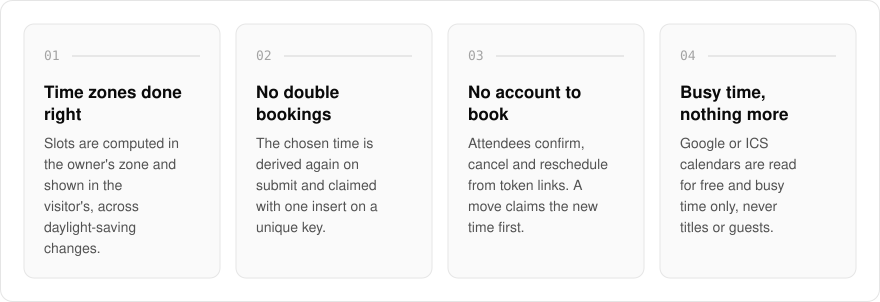
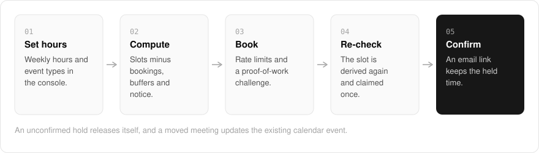

  <picture>
    <source media="(prefers-color-scheme: dark)" srcset=".github/assets/hero-dark.png">
    
  </picture>

<h1 align="center">meet.me.at</h1>

<strong>Booking pages that get time zones right.</strong>

  
  
  
  

  <a href="#features">Features</a> ·
  <a href="#how-it-works">How it works</a> ·
  <a href="#screenshots">Screenshots</a> ·
  <a href="#built-with">Built with</a>

Sharing open times goes wrong in two familiar ways: a slot that is an hour off after a clock change, and two people landing the same opening. I built meet.me.at so availability is computed in the owner's time zone and shown in the visitor's, across daylight-saving changes, after buffers and notice, and checked again on submit so a double booking cannot succeed. An owner sets up weekly hours and event types in a signed-in console; attendees book, confirm, cancel and reschedule from links, with no account needed.

  <picture>
    <source media="(prefers-color-scheme: dark)" srcset=".github/assets/overview-dark.svg">
    
  </picture>

## Why meet.me.at

| The usual booking link | meet.me.at |
| --- | --- |
| Slots that can slip around a daylight-saving change | Daylight-saving transitions handled inside the slot calculation |
| Two people can grab the same opening | The time is derived again on submit and claimed once on a unique key |
| A rescheduled meeting adds a second calendar event | ICS sequence numbers update the existing event in place |
| Reads everything on your calendar | Reads free and busy time only, never titles or guests |

## Features

- **Time zones and daylight saving**: slots are computed in the owner's zone and shown in the visitor's, with daylight-saving transitions handled inside the calculation.
- **Re-checked on submit**: the chosen time is derived again from scratch when the form is submitted, and claimed with a single insert on a unique key, so a double booking cannot succeed.
- **Buffers, notice and expiring holds**: existing bookings, buffers and minimum notice are removed from availability, and an unconfirmed hold releases itself.
- **Cancel and reschedule without an account**: attendee links carry a random token; rescheduling claims the new time before releasing the old one.
- **Calendar files that update in place**: ICS files carry an increasing sequence number, so a moved meeting updates the existing event instead of adding a second one.
- **Busy time from your calendars**: a connected Google calendar or a pasted ICS feed is read for free and busy time only, never titles or guests, with credentials stored encrypted.
- **Spam protection**: every booking submission passes rate limits and a proof-of-work challenge.
- **Owner console**: availability, event types, routing forms and webhooks behind sign-in.
- **Self-hostable**: run your own instance from the Docker Compose kit; a license key unlocks the Pro tier.

## How it works

  <picture>
    <source media="(prefers-color-scheme: dark)" srcset=".github/assets/flow-dark.svg">
    
  </picture>

The owner's weekly hours become open slots once existing bookings, buffers, minimum notice and busy time from connected calendars are taken out. A booking passes rate limits and a proof-of-work challenge, then the chosen time is derived again from scratch and claimed with one insert, so only one person can win it. The attendee confirms from the email link, and a hold that is never confirmed releases itself.

## Screenshots

<table>
  <tr>
    <td width="50%"><picture><source media="(prefers-color-scheme: dark)" srcset=".github/assets/confirm-dark.png"></picture> Confirm booking: the attendee keeps a held time by confirming from the email link.</td>
    <td width="50%"><picture><source media="(prefers-color-scheme: dark)" srcset=".github/assets/cancel-dark.png"></picture> Cancel booking: release the time, or pick a new one instead, without an account.</td>
  </tr>
</table>

## Built with

  
  
  
  
  
  
  

- Next.js 16 (App Router), React 19, TypeScript
- Tailwind CSS 4
- Drizzle ORM + Postgres
- Better Auth
- oRPC
- Google Calendar API (free/busy) and ICS build, parse and RRULE expansion
- Resend for booking mail

## Part of the me.at family

meet.me.at is one of my [`*.me.at`](https://me.at) apps. They share one design system, account, and app shell. Development happens in a private monorepo; this repository is the project's public-facing home.

## License

Source-available. See [LICENSE](LICENSE).
