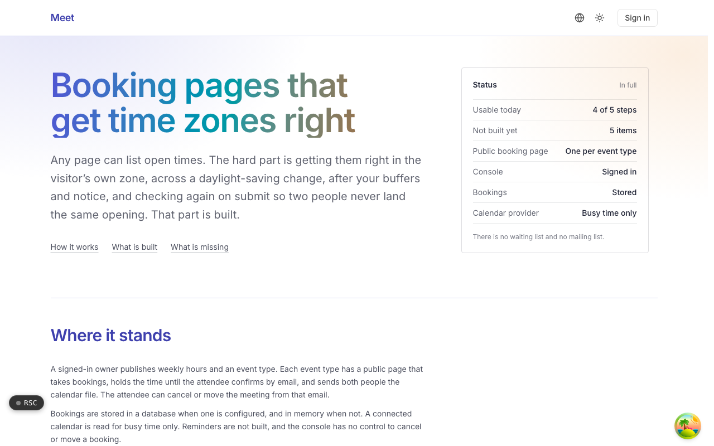
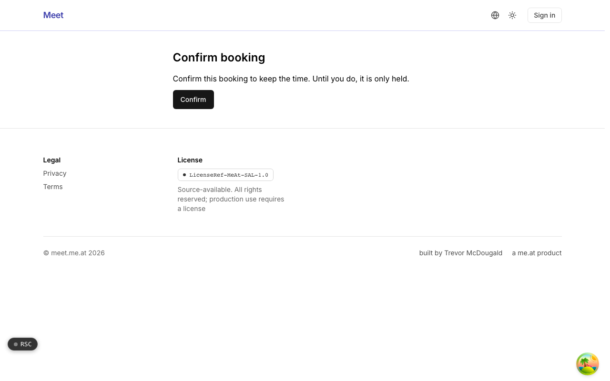
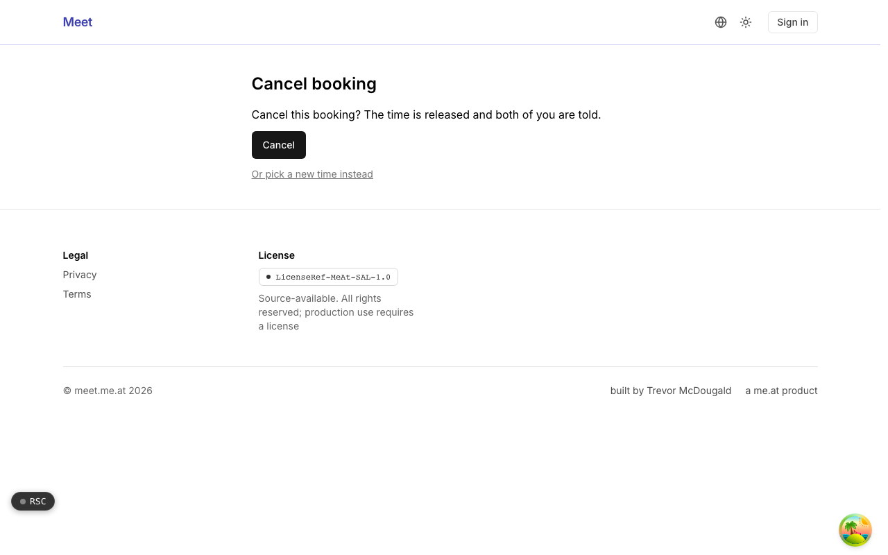

  <picture>
    <source media="(prefers-color-scheme: dark)" srcset=".github/assets/hero-dark.png">
    
  </picture>

# meet.me.at

Booking pages that get time zones right.

meet.me.at is a scheduling app for people who want to share open times without the usual mistakes. Availability is computed in the owner's time zone and shown in the visitor's, across daylight-saving changes, after buffers and notice, and it is checked again on submit so two people never land the same opening. An owner sets up weekly hours and event types in a signed-in console; attendees book, confirm, cancel and reschedule from links, with no account needed.

**Live:** [meet.me.at](https://meet.me.at)

## Features

- **Time zones and daylight saving**: slots are computed in the owner's zone and shown in the visitor's, with daylight-saving transitions handled inside the calculation.
- **Re-checked on submit**: the chosen time is derived again from scratch when the form is submitted, and claimed with a single insert on a unique key, so a double booking cannot succeed.
- **Buffers, notice and expiring holds**: existing bookings, buffers and minimum notice are removed from availability, and an unconfirmed hold releases itself.
- **Cancel and reschedule without an account**: attendee links carry a random token; rescheduling claims the new time before releasing the old one.
- **Calendar files that update in place**: ICS files carry an increasing sequence number, so a moved meeting updates the existing event instead of adding a second one.
- **Busy time from your calendars**: a connected Google calendar or a pasted ICS feed is read for free and busy time only, never titles or guests, with credentials stored encrypted.
- **Spam protection**: every booking submission passes rate limits and a proof-of-work challenge.
- **Owner console**: availability, event types, routing forms and webhooks behind sign-in.

## Screenshots

<table>
  <tr>
    <td width="50%"><picture><source media="(prefers-color-scheme: dark)" srcset=".github/assets/confirm-dark.png"></picture> Confirm booking: the attendee keeps a held time by confirming from the email link.</td>
    <td width="50%"><picture><source media="(prefers-color-scheme: dark)" srcset=".github/assets/cancel-dark.png"></picture> Cancel booking: release the time, or pick a new one instead, without an account.</td>
  </tr>
</table>

## Built with

- Next.js 16 (App Router), React 19, TypeScript
- Tailwind CSS 4
- Drizzle ORM + Postgres
- Better Auth
- oRPC
- Google Calendar API (free/busy) and ICS build, parse and RRULE expansion
- Resend for booking mail

## Part of the me.at family

meet.me.at is one of the [`*.me.at`](https://me.at) apps by Trevor McDougald. They share one design system, account, and app shell. Development happens in a private monorepo; this repository is the project's public-facing home.

## License

See [LICENSE](LICENSE).
